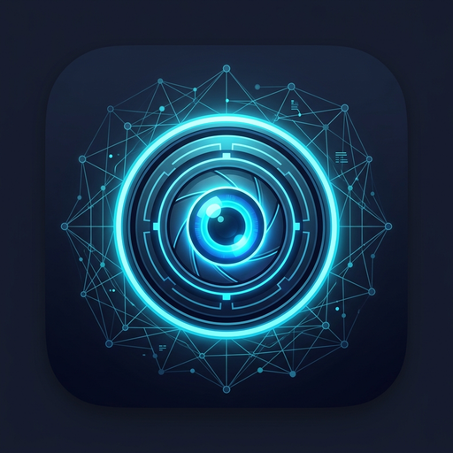
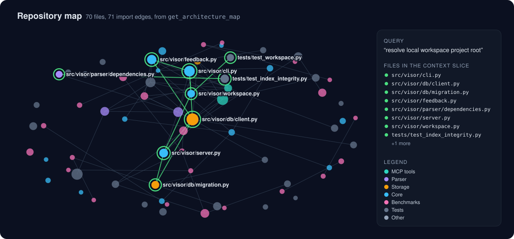
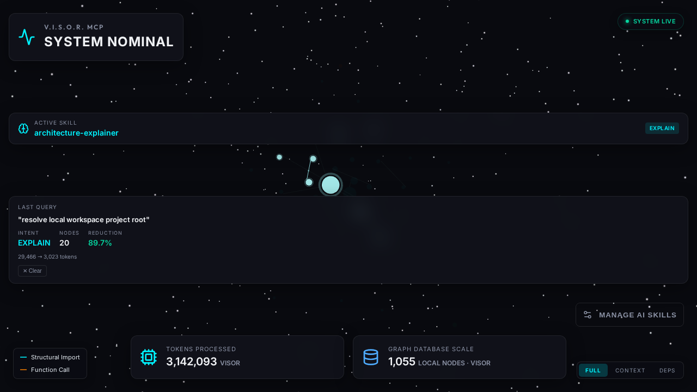

<div align="center">
  
  <h1>V.I.S.O.R.</h1>
  <p><strong>Give your coding agent a map of your repo, so it opens the right files first.</strong></p>
  <p>A local-first context engine for Claude Code, Codex, Cursor, and any MCP client.</p>
</div>

[](https://github.com/dibun75/visor/actions/workflows/ci.yml) [](https://pypi.org/project/visor-mcp/) [](https://open-vsx.org/extension/dibun75/visor-hud) [](https://open-vsx.org/extension/dibun75/visor-hud) [](LICENSE) [](pyproject.toml)

V.I.S.O.R. indexes your repository with Tree-sitter into a local symbol index and dependency graph. Ask it a question in plain language and it returns the files and symbols that matter, with a reason for each pick. Your agent gets a focused starting point instead of grepping its way in. Everything runs on your machine, and the default mode works offline.

<div align="center">
  
  <p><sub>V.I.S.O.R.'s map of its own repository, from the real <code>get_architecture_map</code> output. Green rings mark the files <code>build_context</code> picked for one query. Regenerate it with <a href="./demo/render_repo_map.py"><code>demo/render_repo_map.py</code></a>.</sub></p>
</div>

## Install

You need [`uv`](https://docs.astral.sh/uv/getting-started/installation/). Then, in your repository:

```bash
uvx --from visor-mcp visor install                         # wire up Claude Code, Codex, Cursor, Gemini CLI
uvx --from visor-mcp visor index                           # build the local map
uvx --from visor-mcp visor context "how is auth handled?"  # ask it something
```

That is the whole setup. Your agent can now call `build_context` and the other V.I.S.O.R. tools. Add `--dry-run` to `visor install` to preview the changes first.

## Quickstart

1. **Check your setup.** `uvx --from visor-mcp visor doctor` reports what works on this machine.
2. **Index once.** `visor index` parses the repository and stores the graph under `~/.visor/`. A file watcher keeps it current while the MCP server runs.
3. **Ask a question.** `visor context "<question>"` prints the ranked files and symbols with reasons. Add `--json` for machine-readable output, or `--skill bug-fixer` to rank for a bug hunt.
4. **Connect your agent.** `visor install` detects Claude Code, Codex CLI, Cursor, and Gemini CLI, registers the `visor` MCP server in each client's user config, and copies the [`visor-context` Agent Skill](./skills/visor-context/SKILL.md) so the agent knows when to ask V.I.S.O.R. first. It prints every file it changes, keeps a `.visor-backup` copy of each edited config, leaves other servers and settings alone, and skips an existing `visor` entry or edited Skill unless you pass `--force`. Use `--client <name>` for one client, `--hook` for an opt-in Claude Code SessionStart check, and `visor uninstall` to remove what it added. Prefer to do it by hand? `claude mcp add visor -- uvx visor-mcp` or `codex mcp add visor -- uvx visor-mcp`, or `visor init` to print an MCP entry for review.


<sub>Recorded from [`demo/terminal_demo.tape`](./demo/terminal_demo.tape). Also available as [`terminal-demo.mp4`](./docs/assets/terminal-demo.mp4).</sub>

## Before and after

Say you ask an agent to change how V.I.S.O.R. finds the project root.

**Without V.I.S.O.R.**, the agent has to discover the code first: search for likely words, list directories, open candidate files, and read until it finds the right functions.

**With V.I.S.O.R.**, one call returns a ranked starting point. This is real output on this repository (trimmed to the first entries, paths shortened):

```text
$ visor context "resolve local workspace project root"
  Query:  resolve local workspace project root
  Selected 20 nodes (truncated=False):

  [2.0000]  src/visor/workspace.py:resolve_local_workspace
            → Matched query token in symbol name
            → Co-located in same file as top lexical hit
            → Reachable via dependency chain
  [2.0000]  src/visor/workspace.py:find_git_root
  [2.0000]  src/visor/workspace.py:is_project_dir
  [2.0000]  src/visor/workspace.py:resolve_mcp_roots
  [1.0000]  src/visor/server.py:WorkspaceManager
            → Matched query token in symbol name
  [1.0000]  src/visor/cli.py:_init_workspace
  ...
```

The agent still reads and verifies the code. V.I.S.O.R. tells it where to start and why, so the reasons are leads, not proof.

## Does it help?

In our published pilots, agents with V.I.S.O.R. finished navigation tasks a few seconds faster, with no measurable change in patch correctness, and the pilots are small. Full numbers, methods, and limits are in **[BENCHMARKS.md](./BENCHMARKS.md)**.

## How it works

- **Parse.** Tree-sitter extracts classes, functions, imports, and calls for nine languages.
- **Store.** Symbols and edges go into a per-workspace SQLite database under `~/.visor/`, with a NetworkX dependency graph on top.
- **Rank.** `build_context` classifies the question's intent, scores symbols by name match, same-file proximity, dependency hops, recency, and (optionally) embeddings, and attaches the reason behind each score.
- **Learn from you, if you want.** `visor feedback` records that a file was useful, irrelevant, or missing for a query, and nudges similar future queries in the same workspace. You can list or delete it at any time.

More detail: [`docs/ARCHITECTURE.md`](./docs/ARCHITECTURE.md).

## Supported integrations

| Client | How it connects |
| --- | --- |
| Codex CLI | `visor install`, or `codex mcp add visor -- uvx visor-mcp` |
| Claude Code | `visor install`, or `claude mcp add visor -- uvx visor-mcp` |
| Cursor | `visor install`, or `~/.cursor/mcp.json` |
| Gemini CLI | `visor install`, or `~/.gemini/settings.json` |
| Claude Desktop | `claude_desktop_config.json` |
| VS Code | `.vscode/mcp.json`, plus the optional [HUD](https://open-vsx.org/extension/dibun75/visor-hud) |
| Antigravity | The VS Code MCP file above, plus the optional HUD |
| Terminal | `visor doctor`, `visor index`, `visor context` |

Any other MCP client can launch the same stdio command: `uvx visor-mcp`.

<details>
<summary><b>Manual Cursor, VS Code, and Claude Desktop configuration</b></summary>

**Cursor** (`~/.cursor/mcp.json`):

```json
{
  "mcpServers": {
    "visor": {
      "command": "uvx",
      "args": ["visor-mcp"]
    }
  }
}
```

**VS Code** (`.vscode/mcp.json`). The same file is the setup documented here for Antigravity:

```json
{
  "servers": {
    "visor": {
      "command": "uvx",
      "args": ["visor-mcp"]
    }
  }
}
```

**Claude Desktop** (`claude_desktop_config.json`):

```json
{
  "mcpServers": {
    "visor": {
      "command": "uvx",
      "args": ["visor-mcp"]
    }
  }
}
```

</details>

## Agent Skill

The Skill tells an agent to request V.I.S.O.R. context, treat the files, symbols, and reasons as leads, and verify those leads in the repository. Installing it does not guarantee that every client will select it automatically.

- Skill source: [`skills/visor-context/SKILL.md`](./skills/visor-context/SKILL.md)
- Install notes for Codex, Claude Code, and other clients: [`docs/AGENT_SKILL.md`](./docs/AGENT_SKILL.md)

## Local-first and privacy

- The index and dependency graph are stored locally, under `~/.visor/`.
- Lexical retrieval works offline and does not download a model.
- Semantic mode is optional (`visor --retrieval-mode semantic` or `VISOR_RETRIEVAL_MODE=semantic`) and uses `all-MiniLM-L6-v2`, which may be downloaded on first use.
- V.I.S.O.R. itself does not require uploading the whole repository to a hosted V.I.S.O.R. service. The MCP server speaks stdio.
- Retrieved snippets are still passed to whichever coding agent the user has configured, subject to that provider's policies.

`store_memory` embeds the stored text with the semantic model. Lexical indexing does not.

## Languages

Tree-sitter parsing covers nine languages. TSX uses the TypeScript grammar's TSX variant. It is not a tenth language.

| Language | Extensions |
| --- | --- |
| Python | `.py` |
| TypeScript | `.ts`, `.tsx` |
| JavaScript | `.js`, `.jsx` |
| Go | `.go` |
| Rust | `.rs` |
| Java | `.java` |
| C | `.c`, `.h` |
| C++ | `.cpp`, `.cc`, `.cxx`, `.hpp` |
| C# | `.cs` |

Adding a language is a small parser change. See [CONTRIBUTING.md](./CONTRIBUTING.md#how-to-add-a-new-language-most-common-contribution).

## CLI

```bash
visor doctor
visor index
visor status
visor init
visor install --dry-run
visor uninstall
visor context "how is auth handled"
visor fix "login crash on null user"
visor explain "database client"
visor trace src/visor/server.py src/visor/workspace.py
visor drift
visor map --open
visor feedback useful src/app.py --query "how is auth handled"
visor feedback list --json
```

`visor map` writes a self-contained, shareable HTML dependency map (`visor-map.html`) and `VISOR_REPORT.md` with hub files, entry points, most-depended-on symbols, and import cycles. See [docs/TERMINAL.md](docs/TERMINAL.md#shareable-map).

`visor feedback` stores an explicit useful, irrelevant, or missing verdict for a file and query. V.I.S.O.R. can apply that feedback to similar future queries in the same workspace. It is not automatic learning, it does not change import or call edges, and `visor feedback delete` or `visor feedback clear --yes` removes it.

`fix` and `explain` call `build_context` with `bug-fixer` and `architecture-explainer`. Terminal details: [`docs/TERMINAL.md`](./docs/TERMINAL.md).

## MCP tools

The server registers 21 tools in `src/visor/tools/core.py` and `src/visor/server.py`. `get_visor_skill` is an MCP prompt, not one of those tools. Clients do not have to call any of them automatically.

| Category | Tools |
| --- | --- |
| Intelligence | `build_context` |
| Search | `search_codebase`, `get_symbol_context`, `get_file_context` |
| Graph | `get_dependency_chain`, `impact_analysis`, `trace_route`, `dead_code_detection` |
| Drift | `get_drift_report` |
| Memory and skills | `store_memory`, `list_custom_skills`, `add_custom_skill`, `delete_custom_skill` |
| Feedback | `record_context_feedback`, `list_context_feedback`, `delete_context_feedback`, `clear_context_feedback` |
| HUD | `get_architecture_map`, `get_telemetry`, `set_hud_focus` |
| Server | `health_check` |

Reference: [`docs/MCP_TOOLS.md`](./docs/MCP_TOOLS.md).

## Optional visual HUD

Prefer to explore the graph visually? The [V.I.S.O.R. HUD](https://open-vsx.org/extension/dibun75/visor-hud) is a VS Code / Open VSX extension that draws the indexed graph and shows local telemetry. The CLI and MCP server do not need it. Extension notes: [`src/visor/extension/README.md`](./src/visor/extension/README.md).

<div align="center">
  
  <p><sub>Captured from this repository's real tool outputs with <code>node demo/capture_hud.mjs</code>. The token panel is V.I.S.O.R.'s local byte-based estimate, not measured agent usage.</sub></p>
</div>

## Documentation

| Document | Contents |
| --- | --- |
| [`docs/TERMINAL.md`](./docs/TERMINAL.md) | Offline lexical workflow and semantic opt-in |
| [`docs/AGENT_SKILL.md`](./docs/AGENT_SKILL.md) | Skill installation notes |
| [`docs/MCP_TOOLS.md`](./docs/MCP_TOOLS.md) | Tool reference |
| [`BENCHMARKS.md`](./BENCHMARKS.md) | Published pilot results, methods, and limits |
| [`docs/ARCHITECTURE.md`](./docs/ARCHITECTURE.md) | Local index, graph, and retrieval design |
| [`docs/FAQ.md`](./docs/FAQ.md) | Common questions |
| [`docs/TROUBLESHOOTING.md`](./docs/TROUBLESHOOTING.md) | Setup failures |
| [`CONTRIBUTING.md`](./CONTRIBUTING.md) | Development setup and new languages |
| [`SECURITY.md`](./SECURITY.md) | Supported versions and private vulnerability reports |
| [`CHANGELOG.md`](./CHANGELOG.md) | Release notes |

## Community

If V.I.S.O.R. saves you time, [a star](https://github.com/dibun75/visor) helps other coding-agent users find it.

- [Report a bug](https://github.com/dibun75/visor/issues/new?template=bug_report.yml)
- [Request a feature](https://github.com/dibun75/visor/issues/new?template=feature_request.yml)
- [Contributing](./CONTRIBUTING.md)
- [Security reports](./SECURITY.md)

Please follow the [Code of Conduct](./CODE_OF_CONDUCT.md) when participating.

```bash
git clone https://github.com/dibun75/visor.git
cd visor && uv sync --dev
uv run pytest tests/ -v
```

## License

MIT © [Arunav Mandal](https://github.com/dibun75)
