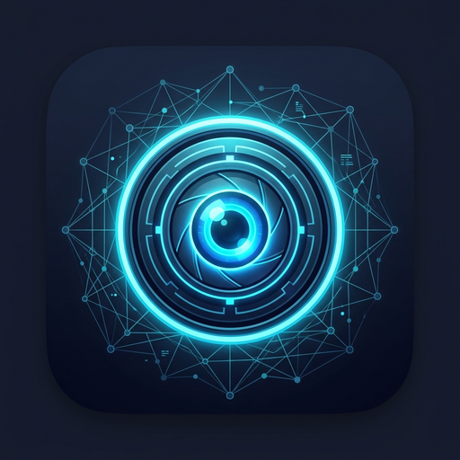
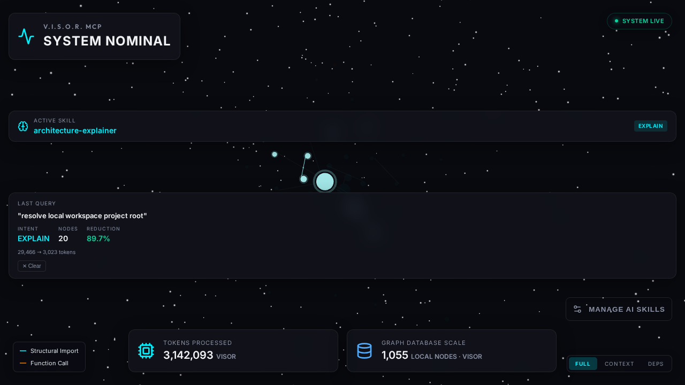

<div align="center">
  
  <h1>V.I.S.O.R.</h1>
  <p><strong>Local-first context retrieval for Codex, Claude Code, and terminal coding agents.</strong></p>
</div>

[](https://github.com/dibun75/visor/actions/workflows/ci.yml) [](https://pypi.org/project/visor-mcp/) [](https://open-vsx.org/extension/dibun75/visor-hud) [](LICENSE) [](pyproject.toml)

V.I.S.O.R. is a local-first context engine for Codex, Claude Code, and other coding agents. It builds an AST-backed repository index and dependency graph, then returns focused code context with the files, symbols, and reasons behind each selection.

It works from the terminal, through the [Agent Skill](./skills/visor-context/SKILL.md), or over MCP. Lexical retrieval is the default and runs offline. Semantic retrieval is optional. A VS Code / Open VSX HUD is optional and is not required for the CLI or MCP server.

## Terminal demo

From a checkout of this repository:

```bash
uv run visor doctor
uv run visor index
uv run visor context "resolve local workspace project root"
```


Recorded from [`demo/terminal_demo.tape`](./demo/terminal_demo.tape). The same take is also at [`docs/assets/terminal-demo.mp4`](./docs/assets/terminal-demo.mp4).

## Quick Start

Prerequisite: [`uv`](https://docs.astral.sh/uv/getting-started/installation/). `uvx` installs `visor-mcp` into a temporary environment.

```bash
# Check local/headless compatibility
uvx --from visor-mcp visor doctor

# Index the current repository
uvx --from visor-mcp visor index

# Retrieve focused context
uvx --from visor-mcp visor context \
  "where is workspace detection handled?"
```

`visor init` prints an MCP configuration entry for review. It does not edit IDE files.

Register the stdio server with Codex or Claude Code:

```bash
codex mcp add visor -- uvx visor-mcp
claude mcp add visor -- uvx visor-mcp
```

<details>
<summary><b>Manual Cursor, VS Code, and Claude Desktop configuration</b></summary>

**Cursor** (`~/.cursor/mcp.json`):

```json
{
  "mcpServers": {
    "visor": {
      "command": "uvx",
      "args": ["visor-mcp"]
    }
  }
}
```

**VS Code** (`.vscode/mcp.json`). The same file is the setup documented here for Antigravity:

```json
{
  "servers": {
    "visor": {
      "command": "uvx",
      "args": ["visor-mcp"]
    }
  }
}
```

**Claude Desktop** (`claude_desktop_config.json`):

```json
{
  "mcpServers": {
    "visor": {
      "command": "uvx",
      "args": ["visor-mcp"]
    }
  }
}
```

</details>

## Agent Skill

The Skill tells an agent to request V.I.S.O.R. context, treat the files, symbols, and reasons as leads, and verify those leads in the repository. Installing it does not guarantee that every client will select it automatically.

- Skill source: [`skills/visor-context/SKILL.md`](./skills/visor-context/SKILL.md)
- Install notes for Codex, Claude Code, and other clients: [`docs/AGENT_SKILL.md`](./docs/AGENT_SKILL.md)

## Supported integrations

| Client | How it connects |
| --- | --- |
| Codex CLI | `codex mcp add visor -- uvx visor-mcp` |
| Claude Code | `claude mcp add visor -- uvx visor-mcp` |
| Cursor | `~/.cursor/mcp.json` |
| Claude Desktop | `claude_desktop_config.json` |
| VS Code | `.vscode/mcp.json`, plus the optional [HUD](https://open-vsx.org/extension/dibun75/visor-hud) |
| Antigravity | The VS Code MCP file above, plus the optional HUD |
| Terminal | `visor doctor`, `visor index`, `visor context` |

Any other MCP client can launch the same stdio command: `uvx visor-mcp`.

## Measured pilot results

Two published pilots are in this repository. Neither is a universal token-reduction claim. Both depend on the task, agent, model, cache behavior, and context. Provider token fields are not comparable across Codex and Claude Code. V.I.S.O.R. context was supplied as leads and had to be checked against the repository.

### Patch correctness, 31 October 2026

Three seeded fixes, three repeats, Codex and Claude Code, native and V.I.S.O.R., 36 paired cells. Every cell had its own detached worktree. A check command scored the patch after the agent. Deltas are V.I.S.O.R. minus native. Full figures: [`benchmarks/results/v1.2.1-patch-pilot-summary.json`](./benchmarks/results/v1.2.1-patch-pilot-summary.json).

| Agent | Condition | Patches passed | Median input-token delta | Median output-token delta | Median runtime delta |
| --- | --- | --- | --- | --- | --- |
| Codex | Native | 9/9 | baseline | baseline | baseline |
| Codex | V.I.S.O.R. | 9/9 | −6,352 (95% CI −55,316 to 36,583) | +78 (95% CI −324 to 192) | −0.2 s (95% CI −10.2 s to 6.6 s) |
| Claude Code | Native | 9/9 | baseline | baseline | baseline |
| Claude Code | V.I.S.O.R. | 9/9 | −2 (95% CI −2 to 0) | +50 (95% CI −219 to 303) | +0.4 s (95% CI −2.0 s to 1.3 s) |

All 36 patches passed. The token and runtime intervals are wide and, except for Claude's two-token uncached input difference, include both directions. Claude's `input_tokens` value is the uncached remainder; cache-read tokens are a separate field and that paired interval also crosses zero. Codex does not report monetary cost. This does not show that V.I.S.O.R. saves a fixed share of tokens.

### Diagnostic navigation, v1.2.0

The v1.2.0 diagnostic pilot compared native repository navigation with the same tasks plus V.I.S.O.R. context. Figures are from [`benchmarks/results/v1.2.0-diagnostic-pilot-summary.json`](./benchmarks/results/v1.2.0-diagnostic-pilot-summary.json). Paired intervals were recomputed from the preserved scored records.

| Fact | Value |
| --- | --- |
| Successful records | 144 |
| Failed records | 0 |
| Tasks | 12 diagnostic navigation tasks |
| Repeats | 3 |
| Native/V.I.S.O.R. pairs per agent | 36 |
| Codex median paired duration delta | −4.17 s (95% CI −8.22 s to −2.21 s) |
| Claude Code median paired duration delta | −3.63 s (95% CI −6.68 s to −0.91 s) |
| Median evidence recall | 100% in both native and V.I.S.O.R. conditions |

Limitations:

- The navigation pilot does not measure patch correctness, refactoring quality, or task success.
- The patch pilot is three small fixtures, not a general coding benchmark.
- Timing and token counts are machine-, model-, provider-, plan-, and cache-dependent.
- Evidence recall is a heuristic, not human correctness review.
- These results are not proof that V.I.S.O.R. makes coding agents universally faster, cheaper, or better.

Protocol: [`benchmarks/README.md`](./benchmarks/README.md). Published-result notes: [`benchmarks/results/README.md`](./benchmarks/results/README.md).

## Why V.I.S.O.R.

V.I.S.O.R. complements normal repository inspection, including an agent's own search. It adds a persistent local index the agent can query.

| Property | What the implementation provides |
| --- | --- |
| Persistent local index | Project graph stored under `~/.visor/` |
| AST symbol extraction | Tree-sitter classes, functions, and imports |
| Dependency graph | Import edges used by trace, impact, and context scoring |
| Terminal interface | `visor doctor`, `index`, `status`, `context`, `fix`, `explain`, `trace`, `drift` |
| MCP integration | 17 stdio tools, including `build_context` and `health_check` |
| Agent Skill | [`skills/visor-context/SKILL.md`](./skills/visor-context/SKILL.md) directs verification of leads |
| Drift detection | Hash comparison and recent file-changelog warnings |
| Optional visual HUD | VS Code / Open VSX extension; CLI and MCP work without it |
| Offline lexical retrieval | Default mode. No model download on the lexical path |

`build_context` classifies a query into an intent profile, can apply a built-in skill (`bug-fixer`, `architecture-explainer`, `refactor-assistant`, `performance-optimizer`), and returns a reason string for each selected node. Those reasons explain the score. They do not establish that the selection is sufficient for a code change.

Each context response also includes an internal size estimate: tokens for the full text of candidate files compared with tokens for the returned snippets. That estimate is not a measured change in agent token use.

## Optional visual HUD

The HUD is a VS Code extension that draws the indexed graph and shows local telemetry. The MCP server and CLI do not need it.

Install **V.I.S.O.R. HUD** from the editor's extension view or [Open VSX](https://open-vsx.org/extension/dibun75/visor-hud). Extension notes: [`src/visor/extension/README.md`](./src/visor/extension/README.md).

<div align="center">
  
  <p>Current 1280×720 capture generated from this repository's real <code>get_architecture_map</code>, <code>get_telemetry</code>, and <code>build_context</code> outputs. The token panel is V.I.S.O.R.'s local byte-based estimate, not measured agent usage. Reproduce it with <code>node demo/capture_hud.mjs</code>.</p>
</div>

## Local-first and privacy

- The index and dependency graph are stored locally, under `~/.visor/`.
- Lexical retrieval works offline and does not download a model.
- Semantic mode is optional (`visor --retrieval-mode semantic` or `VISOR_RETRIEVAL_MODE=semantic`) and uses `all-MiniLM-L6-v2`, which may be downloaded on first use.
- V.I.S.O.R. itself does not require uploading the whole repository to a hosted V.I.S.O.R. service. The MCP server speaks stdio.
- Retrieved snippets are still passed to whichever coding agent the user has configured, subject to that provider's policies.

`store_memory` embeds the stored text with the semantic model. Lexical indexing does not.

## Languages

Tree-sitter parsing covers nine languages. TSX uses the TypeScript grammar's TSX variant. It is not a tenth language.

| Language | Extensions |
| --- | --- |
| Python | `.py` |
| TypeScript | `.ts`, `.tsx` |
| JavaScript | `.js`, `.jsx` |
| Go | `.go` |
| Rust | `.rs` |
| Java | `.java` |
| C | `.c`, `.h` |
| C++ | `.cpp`, `.cc`, `.cxx`, `.hpp` |
| C# | `.cs` |

Adding a language is a small parser change. See [CONTRIBUTING.md](./CONTRIBUTING.md#how-to-add-a-new-language-most-common-contribution).

## CLI

```bash
visor doctor
visor index
visor status
visor init
visor context "how is auth handled"
visor fix "login crash on null user"
visor explain "database client"
visor trace src/visor/server.py src/visor/workspace.py
visor drift
```

`fix` and `explain` call `build_context` with `bug-fixer` and `architecture-explainer`. Terminal details: [`docs/TERMINAL.md`](./docs/TERMINAL.md).

## MCP tools

The server registers 17 tools in `src/visor/tools/core.py` and `src/visor/server.py`. `get_visor_skill` is an MCP prompt, not one of those tools. Clients do not have to call any of them automatically.

| Category | Tools |
| --- | --- |
| Intelligence | `build_context` |
| Search | `search_codebase`, `get_symbol_context`, `get_file_context` |
| Graph | `get_dependency_chain`, `impact_analysis`, `trace_route`, `dead_code_detection` |
| Drift | `get_drift_report` |
| Memory and skills | `store_memory`, `list_custom_skills`, `add_custom_skill`, `delete_custom_skill` |
| HUD | `get_architecture_map`, `get_telemetry`, `set_hud_focus` |
| Server | `health_check` |

Reference: [`docs/MCP_TOOLS.md`](./docs/MCP_TOOLS.md).

## Documentation

| Document | Contents |
| --- | --- |
| [`docs/TERMINAL.md`](./docs/TERMINAL.md) | Offline lexical workflow and semantic opt-in |
| [`docs/AGENT_SKILL.md`](./docs/AGENT_SKILL.md) | Skill installation notes |
| [`docs/MCP_TOOLS.md`](./docs/MCP_TOOLS.md) | Tool reference |
| [`docs/ARCHITECTURE.md`](./docs/ARCHITECTURE.md) | Local index, graph, and retrieval design |
| [`docs/FAQ.md`](./docs/FAQ.md) | Common questions |
| [`docs/TROUBLESHOOTING.md`](./docs/TROUBLESHOOTING.md) | Setup failures |
| [`CONTRIBUTING.md`](./CONTRIBUTING.md) | Development setup and new languages |
| [`SECURITY.md`](./SECURITY.md) | Supported versions and private vulnerability reports |
| [`CHANGELOG.md`](./CHANGELOG.md) | Release notes |

## Community

- [Report a bug](https://github.com/dibun75/visor/issues/new?template=bug_report.yml)
- [Request a feature](https://github.com/dibun75/visor/issues/new?template=feature_request.yml)
- [Contributing](./CONTRIBUTING.md)
- [Security reports](./SECURITY.md)

A code of conduct is not in the tree. Adding one needs an owner-designated enforcement contact. No contact is designated for that purpose today.

```bash
git clone https://github.com/dibun75/visor.git
cd visor && uv sync --dev
uv run pytest tests/ -v
```

## License

MIT © [Arunav Mandal](https://github.com/dibun75)
