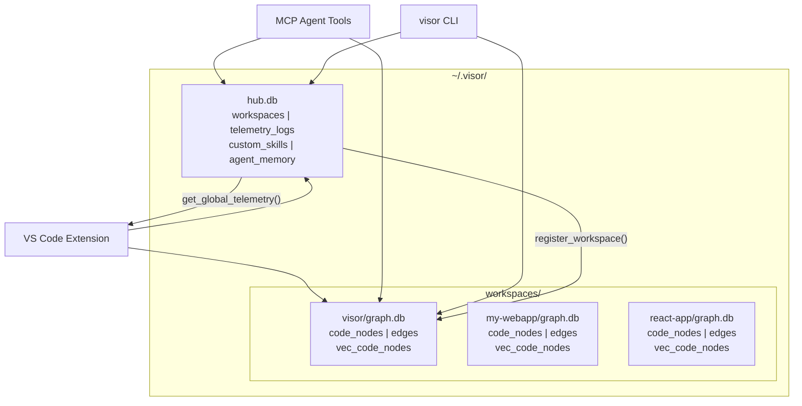

# V.I.S.O.R. Technical Architecture

> **V**isual **I**ntelligence **S**ystem for **O**rchestrated **R**easoning

## Table of Contents

1. [System Overview](#system-overview)
2. [Design Philosophy](#design-philosophy)
3. [Hub-and-Spoke Database Architecture](#hub-and-spoke-database-architecture)
4. [Data Flow](#data-flow)
5. [Database Schema](#database-schema)
6. [Component Breakdown](#component-breakdown)
7. [Embedding Pipeline](#embedding-pipeline)
8. [Context Scoring Engine](#context-scoring-engine)
9. [MCP Server & Tool Registration](#mcp-server--tool-registration)
10. [IDE Extension & 3D HUD](#ide-extension--3d-hud)
11. [Security Model](#security-model)
12. [How to Extend V.I.S.O.R.](#how-to-extend-visor)

---

## System Overview

V.I.S.O.R. is a local-first MCP server and terminal context engine for coding agents. It indexes a repository with Tree-sitter, stores the graph in local SQLite, and returns ranked context with file, symbol, and reason fields. Lexical retrieval is the default. Semantic embeddings are an optional mode. Agents can still search the working tree directly.

```
┌─────────────────────────────────────────────────────────────────┐
│                        Developer IDE                            │
│                                                                 │
│  ┌──────────────┐          ┌──────────────────────────────────┐ │
│  │  AI Agent    │◄────────►│     V.I.S.O.R. MCP Server       │ │
│  │ (Antigravity)│  stdio   │  (FastMCP over stdio transport)  │ │
│  └──────────────┘          └──────────────┬─────────────────┬─┘ │
│                                           │                 │   │
│                              ┌────────────▼──┐   ┌─────────▼─┐ │
│                              │  Hub + Spoke  │   │  NetworkX  │ │
│                              │  SQLite DBs   │   │  DiGraph   │ │
│                              └───────────────┘   └───────────┘ │
│                                                                 │
│  ┌──────────────────────────────────────────────────────────┐   │
│  │              3D HUD (Sidebar / Panel)                │   │
│  │      React + Three.js force-directed 3D graph            │   │
│  └──────────────────────────────────────────────────────────┘   │
└─────────────────────────────────────────────────────────────────┘
```

---

## Design Philosophy

| Principle | Implementation |
|-----------|---------------|
| **Local-first** | All data lives in `~/.visor/` (SQLite). No cloud calls. |
| **Privacy-preserving** | No traffic interception. Communicates via stdio only. |
| **Token-efficient** | Context Scoring Engine ranks and compresses before returning context. |
| **Zero-config** | The CLI discovers a recognized local project; the extension launches a local checkout or `uv tool run visor-mcp`. |
| **Incremental** | File watcher only re-indexes changed files (hash-based cache). |
| **Multi-workspace** | Hub-and-spoke DB separates user-global data from workspace-specific code graphs. |

---

## Hub-and-Spoke Database Architecture

V.I.S.O.R. uses a **dual-database** architecture that separates user-global data from workspace-specific code graphs. This enables portable AI skills, per-project telemetry, and per-project code isolation.



### Directory Layout

```
~/.visor/
├── hub.db                          ← Global: workspaces registry, telemetry,
│                                      custom skills, agent memory
└── workspaces/
    ├── a1b2c3d4e5f6/graph.db       ← Workspace: my-project (code_nodes, edges, vec)
    ├── f6e5d4c3b2a1/graph.db       ← Workspace: my-webapp
    └── 9c8b7a6d5e4f/graph.db       ← Workspace: react-app
```

### Path Resolution

The hub is always `~/.visor/hub.db`. Each project uses
`~/.visor/workspaces/{sha256(workspace_root)[:12]}/graph.db`.

Workspace resolution depends on the entry point:

- CLI and explicit server startup: `--workspace`, then `WORKSPACE_ROOT`, then
  the Git root or a recognized project in the current directory.
- MCP requests: the first valid local project advertised by
  `session.list_roots()`, falling back to the local rules when roots are absent.
- Implicit resolution rejects the home directory and paths without a recognized
  project marker.

The active workspace can change between MCP clients. V.I.S.O.R. reinitializes
its spoke connection and watcher when the resolved project changes.

### Data Classification

| Table | Database | Scope | Reasoning |
|-------|----------|-------|-----------|
| `workspaces` | Hub | Global | Registry of all indexed workspaces |
| `telemetry_logs` | Hub | Global | MCP response bytes by workspace |
| `custom_skills` | Hub | Global | AI strategies should be portable |
| `agent_memory` | Hub | Hybrid | Tagged with `workspace_hash` for filtering |
| `vec_agent_memory` | Hub | Global | Embeddings for memory recall |
| `code_nodes` | Spoke | Workspace | AST of that project's code |
| `edges` | Spoke | Workspace | Import/call graph of that project |
| `vec_code_nodes` | Spoke | Workspace | Embeddings tied to that project's code |
| `file_changelog` | Spoke | Workspace | File drift tracking for that project |
| `ui_state` | Spoke | Workspace | HUD state for the current project view |

### Auto-Migration

On first boot, V.I.S.O.R. automatically discovers old monolith `visor_memory.db` files from previous versions and migrates them:

1. Scans `~/.cache/visor/*/` and known extension storage paths
2. Copies global tables (telemetry, skills, memory) to `hub.db`
3. Copies workspace tables (code_nodes, edges) to the appropriate spoke
4. Registers discovered workspaces in the hub registry
5. Leaves old DBs intact as backups

---

## Data Flow

### Indexing Pipeline

```
visor index, MCP startup, or a watched file change
        ↓
SHA-256 hash compared to DB (cache hit → skip)
        ↓
Tree-sitter parses Python, TypeScript/TSX, JavaScript, Go, Rust,
Java, C, C++, and C#
        ↓
Symbols, imports, and call names are extracted
        ↓
Lexical mode updates SQLite FTS5; semantic mode also embeds nodes
        ↓
Nodes, index metadata, and verified graph edges are committed
```

### Query Pipeline

```
CLI or MCP query
        ↓
SQLite FTS5 search (default) or sqlite-vec search (semantic opt-in)
        ↓
Dependency expansion and multi-signal scoring
        ↓
Explicit workspace feedback adjustment, when applicable
        ↓
8,000-token local snippet budget
        ↓
Ranked context, reasons, and local size estimates returned
        ↓
MCP response byte count logged for HUD telemetry
```

---

## Database Schema

### Hub Database (`~/.visor/hub.db`)

#### `workspaces`
Registry of all indexed workspaces.

| Column | Type | Description |
|--------|------|-------------|
| `hash` | TEXT PK | SHA-256 hash of workspace root (12 chars) |
| `name` | TEXT | Human-readable workspace name (basename) |
| `root_path` | TEXT | Absolute path to workspace root |
| `last_accessed` | DATETIME | Last time this workspace connected |
| `total_nodes` | INTEGER | Cached node count |
| `total_tokens` | INTEGER | Cached total bytes transmitted |

#### `telemetry_logs`
Tracks bytes transmitted per MCP tool call, tagged by workspace.

| Column | Type | Description |
|--------|------|-------------|
| `id` | INTEGER PK | Auto-increment row ID |
| `workspace_hash` | TEXT | Workspace hash for aggregation |
| `workspace_name` | TEXT | Human-readable workspace name |
| `tool_name` | TEXT | Name of the MCP tool called |
| `bytes_transmitted` | INTEGER | Size of the response payload |
| `timestamp` | DATETIME | UTC timestamp |

#### `custom_skills`
User-defined AI instruction packs with optional execution strategies. **Shared globally across all workspaces.**

| Column | Type | Description |
|--------|------|-------------|
| `id` | INTEGER PK | Auto-increment row ID |
| `name` | TEXT | Skill identifier (e.g. `bug-fixer`) |
| `description` | TEXT | One-line summary |
| `content` | TEXT | Full Markdown prompt instructions |
| `strategy` | TEXT | JSON execution strategy (intent overrides, scoring bias) |
| `timestamp` | DATETIME | Created at |

#### `agent_memory`
Episodic memory of agent conversations, tagged with workspace context.

| Column | Type | Description |
|--------|------|-------------|
| `id` | INTEGER PK | Auto-increment row ID |
| `workspace_hash` | TEXT | Workspace context (NULL = global memory) |
| `role` | TEXT | `user` or `assistant` |
| `content` | TEXT | Conversation turn content |
| `timestamp` | DATETIME | UTC timestamp |

#### `vec_agent_memory` (virtual — sqlite-vec)
Stores 384-dimensional float embeddings for agent memory recall.

### Spoke Database (`~/.visor/workspaces/{hash}/graph.db`)

#### `code_nodes`
Primary store for all indexed AST symbols.

| Column | Type | Description |
|--------|------|-------------|
| `id` | INTEGER PK | Auto-increment row ID |
| `file_path` | TEXT | Absolute path to source file |
| `node_type` | TEXT | `class`, `function`, or `import` |
| `name` | TEXT | Symbol name |
| `docstring` | TEXT | Extracted Python docstring (if any) |
| `start_line` | INTEGER | First line of the symbol definition |
| `end_line` | INTEGER | Last line of the symbol definition |
| `file_hash` | TEXT | SHA-256 of the file at last index (cache key) |

#### `edges`
Directed dependency relationships between files.

| Column | Type | Description |
|--------|------|-------------|
| `id` | INTEGER PK | Auto-increment row ID |
| `from_node` | TEXT | Source file path |
| `to_node` | TEXT | Target module or file path |
| `relation_type` | TEXT | e.g. `IMPORTS`, `CALLS`, `INHERITS` |

#### `vec_code_nodes` (virtual — sqlite-vec)
Stores 384-dimensional float embeddings for ANN search.

#### `context_feedback`
Explicit retrieval verdicts for one workspace. Paths are project-relative. The table is created for existing spoke databases on open.

| Column | Type | Description |
|--------|------|-------------|
| `id` | TEXT PK | Stable record id |
| `workspace_hash` | TEXT | Workspace that owns the record |
| `query` | TEXT | Query text supplied by the user or agent |
| `query_signature` | TEXT | Sorted unique tokens longer than two characters |
| `intent` | TEXT | Intent detected when the verdict was recorded |
| `relative_path` | TEXT | Project-relative file path |
| `verdict` | TEXT | `useful`, `irrelevant`, or `missing` |
| `reason` | TEXT | Optional note |
| `file_hash` | TEXT | SHA-256 of the file at record time |
| `index_revision` | INTEGER | Spoke graph revision at record time |
| `created_at` | TEXT | ISO-8601 UTC creation time |
| `updated_at` | TEXT | ISO-8601 UTC update time; decay uses this |
| `application_count` | INTEGER | Times the record affected a later ranking |
| `last_applied_at` | TEXT | Last time it affected a ranking |

#### `file_changelog`
Records file modification events for timestamp-based drift detection.

| Column | Type | Description |
|--------|------|-------------|
| `id` | INTEGER PK | Auto-increment row ID |
| `file_path` | TEXT | Path to modified file |
| `changed_at` | TEXT | ISO-8601 UTC timestamp |

#### `ui_state`
Key-value store for bidirectional HUD state (e.g., agent focus).

| Column | Type | Description |
|--------|------|-------------|
| `key` | TEXT PK | State key (e.g. `agent_focus`) |
| `json_value` | TEXT | JSON-serialized state value |

---

## Component Breakdown

```
visor/
├── server.py               # FastMCP entrypoint + migration + workspace registration + skill seeding
├── cli.py                  # CLI: doctor/index/status/context/trace/drift/feedback
├── db/
│   ├── client.py           # VectorDBClient: dual-connection hub+spoke, schema, CRUD, vector search
│   ├── embeddings.py       # SemanticEmbedder: lazy-loaded all-MiniLM-L6-v2 singleton
│   └── migration.py        # Auto-migration from old monolith DBs to hub-and-spoke
├── parser/
│   ├── treesitter.py       # ASTParser: extracts nodes + edges + file hash per file
│   └── watcher.py          # Watchdog: debounced file watcher + index_workspace boot scan
└── tools/
    ├── core.py             # 20 MCP tools in register_tools(), plus health_check in server.py
    └── context_engine.py   # Context Intelligence Engine: skill-aware scoring + reasoning + metrics
```

---

## Embedding Pipeline

Semantic retrieval uses `sentence-transformers/all-MiniLM-L6-v2`. Lexical mode does not load it.

- **Dimensions**: 384
- **Normalization**: `normalize_embeddings=True` → dot product == cosine similarity
- **Lazy loading**: The model is constructed on the first semantic encode, which may download weights
- **Caching**: `file_hash` prevents re-embedding unchanged files
- **Storage**: Embeddings stored as `float[384]` blobs via `sqlite-vec` virtual table

To upgrade the model (e.g. to `bge-small-en`), change the model name in `embeddings.py`:

```python
self.model = SentenceTransformer("BAAI/bge-small-en-v1.5")
```

---

## Context Scoring Engine

Located in `src/visor/tools/context_engine.py`.

The `build_context(query, skill_name?)` function applies a weighted 5-signal formula to rank candidates returned by the active retrieval backend:

```
score =
  W_exact   × exact_name_match     (query token found in symbol name)
  W_same    × same_file_as_anchor  (same file as the first retrieval hit)
  W_embed   × embedding_similarity (semantic mode only; zero in lexical mode)
  W_dep     × dependency_proximity (1 / (1 + hop_count))
  W_recency × file_recency         (time-decayed modification freshness)
  + feedback_adjustment
```

`feedback_adjustment` is 0 unless an explicit feedback record matches. A match requires Jaccard token overlap of at least 0.6, the same intent, and a file that still exists inside the workspace. Useful and missing verdicts add at most `+0.35`; irrelevant subtracts at most `0.35`. The value is multiplied by `0.5 ** (age_days / 30)`. One record is kept per workspace, normalized query, and project-relative file. Feedback is not an import or call edge. On a tie, ordering continues by file path, symbol name, and node id.

### Intent Profiles

Weights are dynamically adjusted based on intent classification:

| Intent | exact | same | embed | dep | recency |
|--------|-------|------|-------|-----|--------|
| DEFAULT | 1.0 | 0.7 | 0.5 | 0.3 | 0.2 |
| BUG_FIX | 1.0 | 1.5 | 0.4 | 1.2 | 1.0 |
| REFACTOR | 1.5 | 0.5 | 0.3 | 1.5 | 0.1 |
| EXPLAIN | 0.8 | 0.2 | 1.5 | 0.5 | 0.0 |

### Skill Strategy Overrides

When a skill is active, its `strategy.scoring_bias` dict merges with the intent profile, allowing per-skill fine-tuning of weights.

After scoring, a **token budget** of 8,000 tokens is enforced. Code snippets are extracted from source files using AST line boundaries (not generic docstrings). Nodes are added greedily by score until the budget is exhausted.

---

## MCP Server & Tool Registration

V.I.S.O.R. uses `FastMCP` from the `mcp` Python package. Tools are registered via `@mcp.tool()` decorators inside `register_tools(mcp)` in `core.py`.

Tools that transmit context to agents are decorated with `@track_telemetry`, which logs the byte size of each response to `hub.db`'s `telemetry_logs` — powering the live **Agent Context Burn** metric in the HUD. Internal polling endpoints (like `get_architecture_map` and `get_telemetry`) are **not** tracked to prevent metric inflation.

See [`MCP_TOOLS.md`](./MCP_TOOLS.md) for a complete tool reference.

---

## IDE Extension & 3D HUD

The IDE extension (`src/visor/extension/`) serves two roles:

1. **MCP client**: Connects to a local development checkout when present;
   otherwise launches `visor-mcp` with `uv tool run`.
2. **HUD host**: Embeds the React/Three.js frontend as a VS Code webview panel
   or sidebar and forwards MCP results through `postMessage`.

The HUD connects indirectly: the extension translates webview `postMessage` events into MCP tool calls over a stdio client and forwards results back to the webview.

**Key constraint**: `acquireVsCodeApi()` may only be called **once** per Webview lifecycle. V.I.S.O.R. caches the instance in `window.vscodeApiInstance`.

### Telemetry Display

The HUD telemetry panel shows:
- **Tokens processed** for the current workspace (from `hub.db` telemetry_logs filtered by workspace hash)
- **Graph database scale** for the current workspace (from spoke `graph.db`)

---

## Security Model

- **No network proxy**: V.I.S.O.R. does not intercept your IDE's outbound AI requests.
- **No OAuth access**: Your Google or GitHub tokens are never touched.
- **stdio-only**: The MCP server communicates exclusively over stdin/stdout — no open ports.
- **Local index**: `~/.visor/` is not uploaded by V.I.S.O.R. to a hosted V.I.S.O.R. service. Retrieved snippets still go to the configured coding agent under that provider's policies. Semantic mode may download `all-MiniLM-L6-v2`.

---

## How to Extend V.I.S.O.R.

### Add a new MCP Tool

```python
# In src/visor/tools/core.py, inside register_tools():

@mcp.tool()
@track_telemetry
def my_new_tool(param: str) -> str:
    """
    Docstring shown to the AI agent as the tool description.
    Be precise — agents use this to decide when to call the tool.
    """
    # Your implementation here
    return json.dumps({"result": param})
```

### Add a new language to the AST parser

```python
# In src/visor/parser/treesitter.py

import tree_sitter_rust  # pip install tree-sitter-rust

_LANG_RUST = tree_sitter.Language(tree_sitter_rust.language())

_EXT_MAP[".rs"] = _LANG_RUST

_QUERIES[_LANG_RUST] = {
    "function": "(function_item name: (identifier) @name) @node",
    "class":    "(impl_item type: (type_identifier) @name) @node",
    "import":   "(use_declaration) @node",
}
```

### Add a Custom Skill

**Via the HUD UI:**
1. Open the V.I.S.O.R. sidebar in your IDE.
2. Click **MANAGE AI SKILLS**.
3. Fill in Name, Description, and Markdown instructions.
4. Click **+ ADD SKILL**.

**Via MCP tool (with execution strategy):**
```python
add_custom_skill(
    name="my-skill",
    description="Custom debugging strategy",
    content="Focus on error handling and edge cases.",
    strategy='{"intent_override": "BUG_FIX", "scoring_bias": {"recency": 2.0}}'
)
```

The AI can invoke it with: `build_context("my query", skill="my-skill")`.

> **Note**: Custom skills are stored in `hub.db` and shared across all workspaces automatically.

### CLI Commands

V.I.S.O.R. includes a terminal interface:

```bash
uv run visor context "how is auth handled"    # General query
uv run visor fix "login crash"                 # Bug-fixer skill
uv run visor explain "database client"         # Architecture-explainer skill
uv run visor trace src/a.py src/b.py           # Trace path
uv run visor drift                             # Recent file changes
uv run visor init                              # Auto-configure IDE
```
