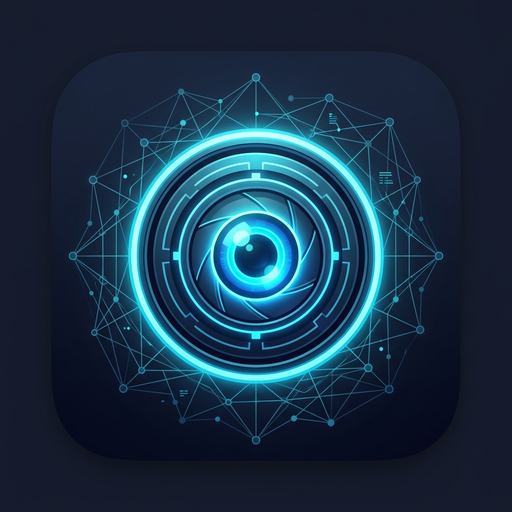
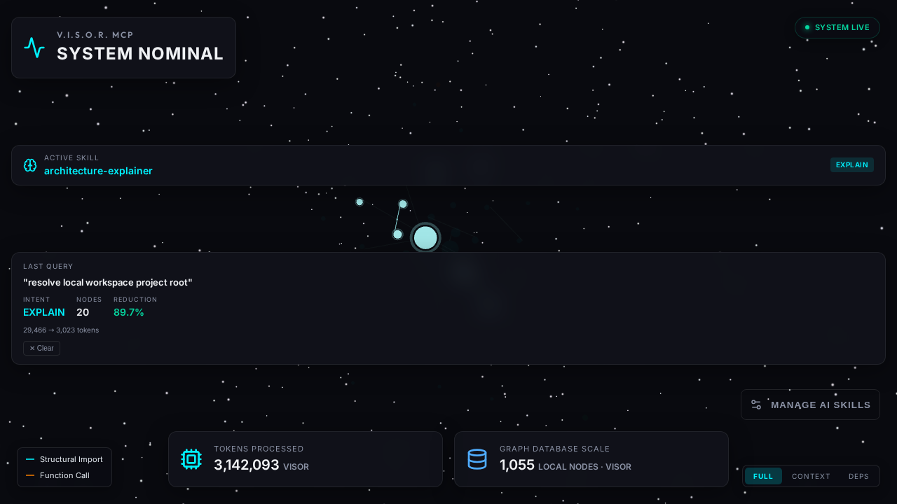

<div align="center">
  
  <h1>V.I.S.O.R. HUD</h1>
  <p>Optional 3D view of a local V.I.S.O.R. index.</p>
</div>

The HUD is optional. Context retrieval lives in the `visor` CLI and the `visor-mcp` stdio server. Both work without this extension.

The extension draws the indexed dependency graph in the editor and polls `get_telemetry`. That payload contains:

- `graph_nodes`: count of indexed code nodes for the workspace
- `context_burn`: sum of recorded MCP payload bytes for the workspace, shown in the HUD as tokens after dividing by 4
- `drift_alert` and `drift_files`: files whose changelog entries are newer than 120 seconds
- `agent_focus`: present after a client calls `set_hud_focus`
- `workspace_name`

`context_burn` is local tool-payload accounting. It is not provider token usage and it is not a measure of retrieval quality.

<div align="center">
  
  <p>Current capture generated from this repository's local graph and telemetry outputs. The values are a UI demonstration, not measured agent usage.</p>
</div>

## Install and verify the server

Install [`uv`](https://docs.astral.sh/uv/getting-started/installation/), then check the CLI:

```bash
uvx --from visor-mcp visor doctor
uvx --from visor-mcp visor index
```

Codex and Claude Code can register the server directly:

```bash
codex mcp add visor -- uvx visor-mcp
claude mcp add visor -- uvx visor-mcp
```

For VS Code, add `.vscode/mcp.json`:

```json
{
  "servers": {
    "visor": {
      "command": "uvx",
      "args": ["visor-mcp"]
    }
  }
}
```

`visor init` only prints that style of entry. It does not write the file. The
extension launches a local checkout's `src/visor/server.py` during V.I.S.O.R.
development; in other workspaces it uses `uv tool run visor-mcp`. Set
`visor.serverPath` only to override that behavior with an absolute `server.py`
path or a `visor-mcp` executable.

Search for **V.I.S.O.R. HUD** in the editor, or install [dibun75.visor-hud on Open VSX](https://open-vsx.org/extension/dibun75/visor-hud). Open the V.I.S.O.R. activity-bar view, or run **Start V.I.S.O.R. HUD** from the command palette.

## Editors

The extension targets VS Code `^1.80.0` and other editors that install Open VSX extensions, including the Antigravity setup documented in the repository README. Codex, Claude Code, Cursor, and Claude Desktop use the MCP server or the CLI. They do not need this extension to retrieve context.

## Settings

| Setting | Default | Role |
| --- | --- | --- |
| `visor.serverPath` | empty | Optional absolute path to `server.py` or a `visor-mcp` executable. Empty uses local-source discovery and then `uv tool run visor-mcp` |

## What the graph is

The MCP server indexes the workspace and can answer `get_architecture_map`. The webview renders that map. Structural import edges and function-call edges use the legend in the view. Selecting or focusing a node depends on the running HUD and on `set_hud_focus`; this page does not claim a particular focus state for the still above.

## Links

- [GitHub repository](https://github.com/dibun75/visor)
- [Issue tracker](https://github.com/dibun75/visor/issues)
- [Documentation](https://github.com/dibun75/visor#documentation)
- [Open VSX listing](https://open-vsx.org/extension/dibun75/visor-hud)

Useful bug reports are welcome. A [GitHub star](https://github.com/dibun75/visor) helps other coding-agent users discover the project.

## License

MIT
